Hey, Roman here. I write Odoo for a living - modules, migrations, upgrades, and the occasional "why did invoicing stop" message on a Friday evening. Around 100 projects so far, most of them through Upwork.

Most of the code lives in client repos. A few of the purple nodes up there got out though.

Python · OWL · PostgreSQL · Docker · and whatever the client's legacy system happens to be written in

[Upwork](https://www.upwork.com/freelancers/~012ec39779a00d14fe) · springlesmcoutrage@gmail.com
